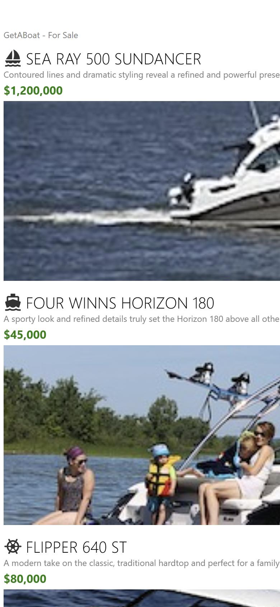
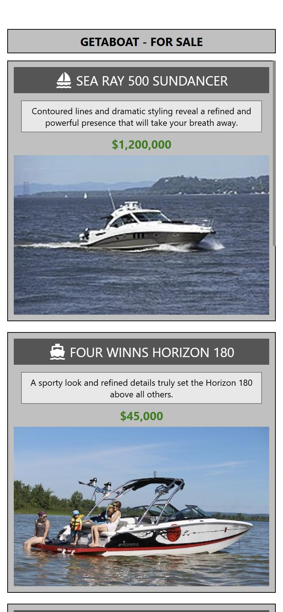
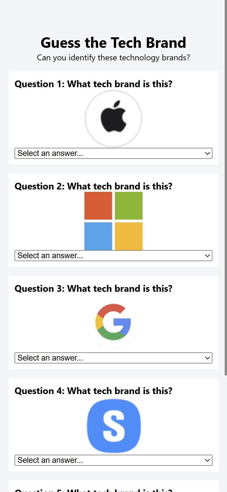
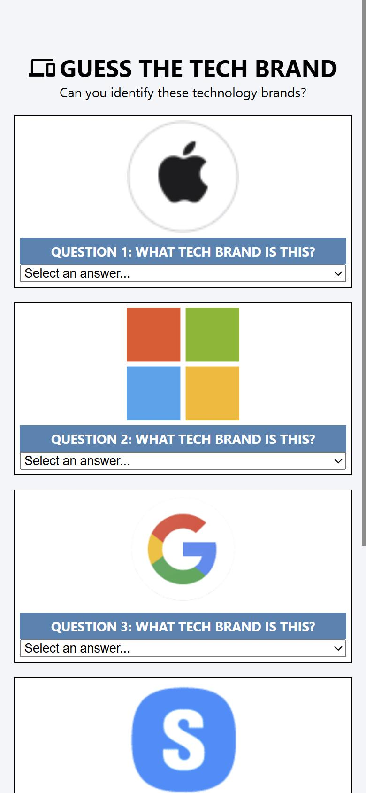

# C346 Lesson 08 – 25037384

Lesson 8 Exercise #5: restyle the Boats app and the Quiz app using **StyleSheets** and **Flexbox props**.

## Folder structure

| Folder / file | Contents |
|---|---|
| `BoatApp/` | Restyled Boat app: `App.js`, `Boat.js` (component), `img/` (boat images), `screenshots/` |
| `QuizApp/` | Restyled Quiz app: `App.js`, `components/Question.js` (component), `questions.js`, `screenshots/` |
| `QUIZ_APP_RECORDING.webm` | Video demo of the quiz app with narration |

Each app is a separate Expo project. To run one, open its folder and run:

```
npm install
npx expo start
```

## Video

- [QUIZ_APP_RECORDING.webm](QUIZ_APP_RECORDING.webm)

---

## 1. Boat app (GetABoat)

### Before and after

| Before | After |
|---|---|
|  |  |

### Styling changes

| Change | Code |
|---|---|
| Header shown as a grey bordered bar with bold, centred, uppercase text | `App.js` → `styles.header` |
| Screen fills the whole height (`flex: 1`) with more side padding | `App.js` → `styles.container` |
| Each boat placed inside a grey card with a black border | `Boat.js` → `styles.container` |
| Icon and boat name in a dark title bar, centred with Flexbox (`flexDirection: 'row'`, `justifyContent: 'center'`, `alignItems: 'center'`) | `Boat.js` → `styles.titleRow`, `styles.name` |
| Description in a light bordered box with centred text | `Boat.js` → `styles.description` |
| Price centred | `Boat.js` → `styles.price` |
| Picture fills the card width | `Boat.js` → `styles.picture` |

---

## 2. Quiz app (Guess the Tech Brand)

### Before and after

| Before | After |
|---|---|
|  |  |

### Styling changes

| Change | Code |
|---|---|
| Inline styles moved into a `StyleSheet` | `App.js`, `components/Question.js` → `StyleSheet.create` |
| Icon and uppercase title placed side by side with Flexbox (`flexDirection: 'row'`, `justifyContent: 'center'`, `alignItems: 'center'`) | `App.js` → `styles.titleRow`, `styles.title` |
| Submit button styled as a blue bar with bold white text | `App.js` → `styles.button`, `styles.buttonText` |
| Each question placed inside a bordered white card | `components/Question.js` → `styles.container` |
| Logo moved above the question and made bigger | `components/Question.js` → `styles.image` |
| Question label shown as a steel-blue bar with white, bold, uppercase, centred text | `components/Question.js` → `styles.label` |
